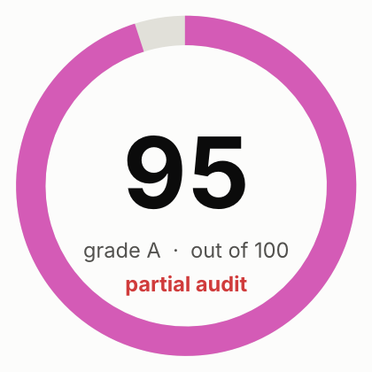
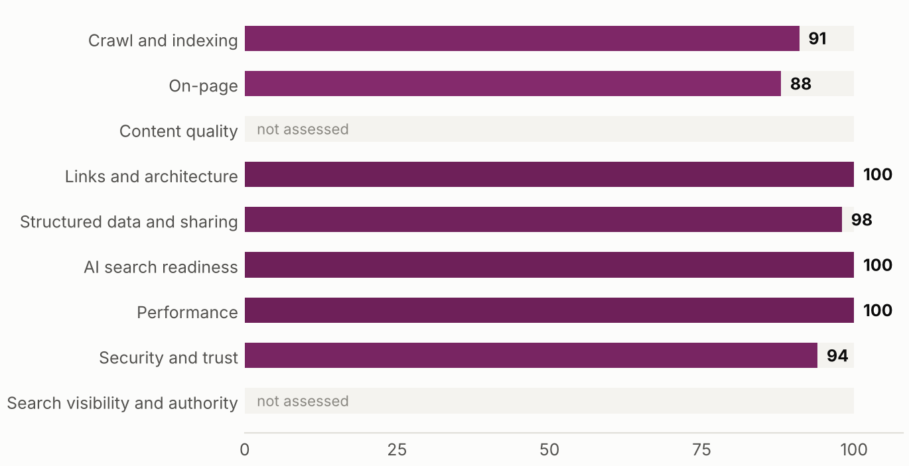
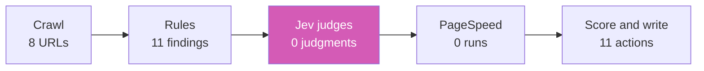
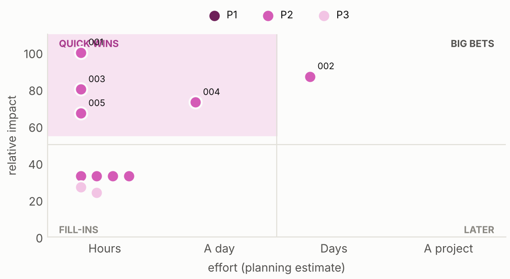
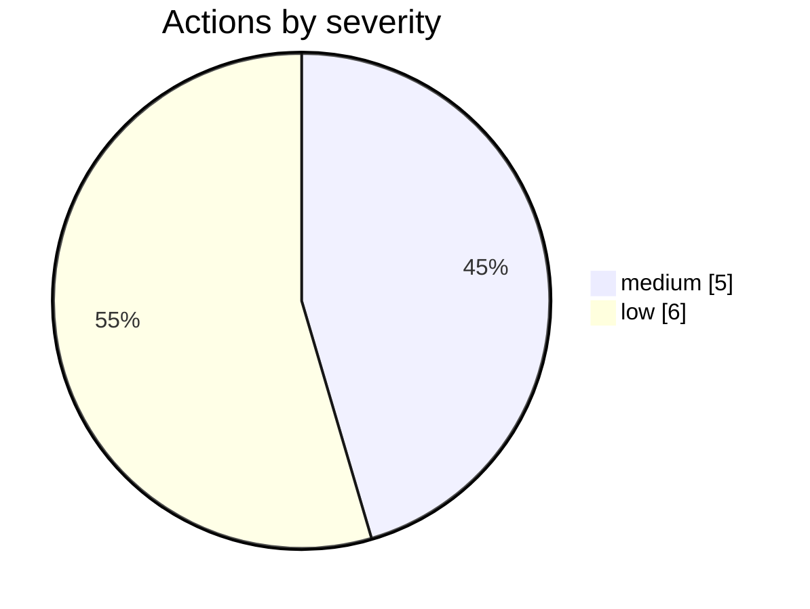
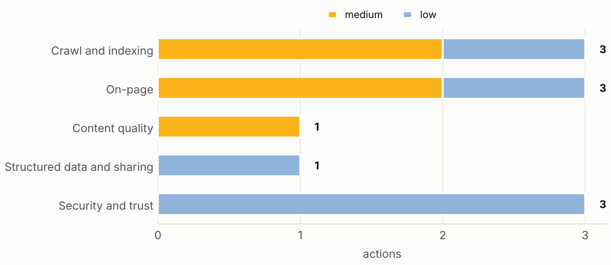
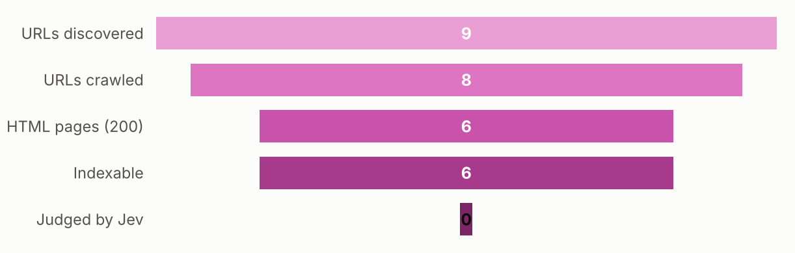
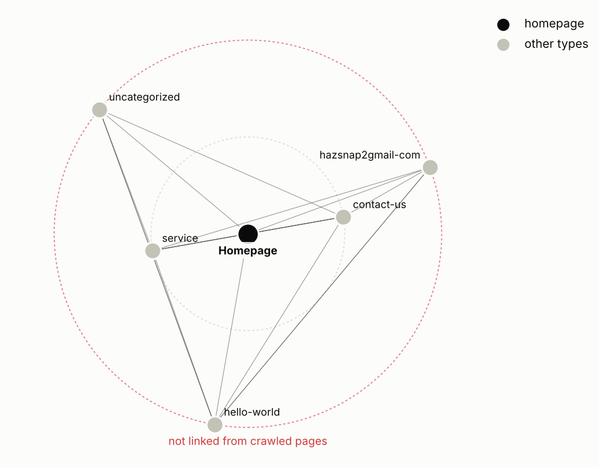

# Jev SEO audit: themomentsandmemories.co.uk

Audited 2026-10-13T13:23:45+00:00 · 8 URLs crawled · 6 HTML pages · 0 Jev judgments · Jev cost $0.0000

**Overall score: 95/100 (grade A)**

> **Partial audit:** Jev judgments unavailable, so content quality was not assessed; PageSpeed Insights unavailable, so performance used crawl timings only. The overall score covers only the areas that were assessed.

| Area | Score | Weight | How it is scored |
|---|---:|---:|---|
| Crawl and indexing | 91 | 20 | Rules only |
| On-page | 88 | 15 | Rules only |
| Content quality | n/a | 20 | Not assessed: Jev judgments unavailable |
| Links and architecture | 100 | 10 | Rules only |
| Structured data and sharing | 98 | 8 | Rules only |
| AI search readiness | 100 | 12 | Rules only: Jev judgments unavailable; editorial heuristics, since Google states no special optimization is required for AI features |
| Performance | 100 | 10 | Crawl observations only: PageSpeed Insights unavailable |
| Security and trust | 94 | 5 | Rules only |
| Search visibility and authority | n/a | 15 | Not assessed: run with --full (DataForSEO) |

**Contents:** [Executive summary](#executive-summary) · [How this audit was made](#how-this-audit-was-made) · [Priority actions](#priority-actions) · [What the crawl found](#what-the-crawl-found) · [Findings by area](#findings-by-area) · [Robots access](#robots-access) · [Page inventory](#page-inventory) · [Method and limits](#method-and-limits)

## Executive summary

themomentsandmemories.co.uk scores 95 out of 100 (grade A) across 7 scored areas. The strongest areas are links and architecture, AI search readiness, performance; the weakest are on-page, crawl and indexing, security and trust. The audit produced 11 actions, 0 of them marked fix first and 3 quick wins.

**What is working**

- Links and architecture scores 100.
- AI search readiness scores 100.
- Performance scores 100.

**What is holding the site back**

- JEV-001: Pages without a meta description (6 indexable pages)
- JEV-002: Pages with very little main content (/contact-us: 73 words; /hello-world: 106 words; /category/uncategorized: 45 words; /author/hazsnap2gmail-com: 47 words)
- JEV-003: Pages without an H1 heading (3 indexable pages)
- JEV-004: Sitemap lists URLs that redirect, fail or are noindex (2 of the crawled sitemap URLs are not final indexable pages)

### Plan

**This week**

- JEV-001 Pages without a meta description
- JEV-003 Pages without an H1 heading
- JEV-005 Redirect chains (more than one hop)

**This month**

- JEV-002 Pages with very little main content
- JEV-004 Sitemap lists URLs that redirect, fail or are noindex
- JEV-006 Open Graph title or image missing
- JEV-007 No Strict-Transport-Security header
- JEV-008 Common security headers missing

**This quarter**

- JEV-010 More than one title element
- JEV-011 Pages without a canonical link

_Written by: Automatic summary (no lead-agent narrative was written)._

## How this audit was made

A source finds, code decides, Jev judges, Claude writes. Code crawls, counts and scores. Jev (TypeSafe's System One model) answers narrow typed questions about meaning, with probabilities. Missing data is shown as missing.

## Priority actions

| ID | Action | Priority | Impact | Effort | Pages | By | Verify |
|---|---|---|---:|---|---:|---|---:|
| JEV-001 | Pages without a meta description (quick win) | P2 Plan next | 100 | Hours | 6 | rule |  |
| JEV-002 | Pages with very little main content | P2 Plan next | 87 | Several days | 4 | rule |  |
| JEV-003 | Pages without an H1 heading (quick win) | P2 Plan next | 80 | Hours | 3 | rule |  |
| JEV-004 | Sitemap lists URLs that redirect, fail or are noindex | P2 Plan next | 73 | About a day | 2 | rule |  |
| JEV-005 | Redirect chains (more than one hop) (quick win) | P2 Plan next | 67 | Hours | 1 | rule |  |
| JEV-006 | Open Graph title or image missing | P2 Plan next | 33 | Hours | 6 | rule |  |
| JEV-007 | No Strict-Transport-Security header | P2 Plan next | 33 | Hours | 1 | rule |  |
| JEV-008 | Common security headers missing | P2 Plan next | 33 | Hours | 1 | rule |  |
| JEV-009 | No favicon declared | P2 Plan next | 33 | Hours | 1 | rule |  |
| JEV-010 | More than one title element | P3 When convenient | 27 | Hours | 3 | rule |  |
| JEV-011 | Pages without a canonical link | P3 When convenient | 24 | Hours | 2 | rule |  |

## What the crawl found

## Findings by area

### Crawl and indexing (91)

**JEV-004 · Sitemap lists URLs that redirect, fail or are noindex** `P2` `medium` `rule`

- Evidence: 2 affected · 2 of the crawled sitemap URLs are not final indexable pages
- Fix: List only final, indexable, HTTP 200 URLs in the sitemap. ([source](https://developers.google.com/search/docs/crawling-indexing/sitemaps/overview))
- URLs: https://themomentsandmemories.co.uk/?wpr_templates=user-header-header, https://themomentsandmemories.co.uk/elementor-hf/header

**JEV-005 · Redirect chains (more than one hop)** `P2` `medium` `rule`

- Evidence: 1 affected · https://themomentsandmemories.co.uk/elementor-hf/header (2 hops)
- Fix: Point each redirect straight at its final URL. ([source](https://developers.google.com/search/docs/crawling-indexing/301-redirects))
- URLs: https://themomentsandmemories.co.uk/elementor-hf/header

**JEV-011 · Pages without a canonical link** `P3` `low` `rule`

- Evidence: 2 affected · 2 of 6 pages
- Fix: Add a self-referencing rel=canonical to each indexable page. ([source](https://developers.google.com/search/docs/crawling-indexing/consolidate-duplicate-urls))
- URLs: https://themomentsandmemories.co.uk/category/uncategorized, https://themomentsandmemories.co.uk/author/hazsnap2gmail-com

### On-page (88)

**JEV-001 · Pages without a meta description** `P2` `medium` `rule`

- Evidence: 6 affected · 6 indexable pages
- Fix: Write a page-specific summary. Google may still generate its own snippet. ([source](https://developers.google.com/search/docs/appearance/snippet))
- URLs: https://themomentsandmemories.co.uk/, https://themomentsandmemories.co.uk/service, https://themomentsandmemories.co.uk/contact-us, https://themomentsandmemories.co.uk/hello-world, https://themomentsandmemories.co.uk/category/uncategorized, https://themomentsandmemories.co.uk/author/hazsnap2gmail-com

**JEV-003 · Pages without an H1 heading** `P2` `medium` `rule` `heuristic`

- Evidence: 3 affected · 3 indexable pages
- Fix: Give each page one visible main heading that states its topic. ([source](https://developers.google.com/search/docs/fundamentals/seo-starter-guide))
- URLs: https://themomentsandmemories.co.uk/, https://themomentsandmemories.co.uk/service, https://themomentsandmemories.co.uk/contact-us

**JEV-010 · More than one title element** `P3` `low` `rule`

- Evidence: 3 affected · 3 pages
- Fix: Keep a single title element in the head. ([source](https://developers.google.com/search/docs/appearance/title-link))
- URLs: https://themomentsandmemories.co.uk/, https://themomentsandmemories.co.uk/service, https://themomentsandmemories.co.uk/contact-us

### Content quality (n/a)

**JEV-002 · Pages with very little main content** `P2` `medium` `rule` `heuristic`

- Evidence: 4 affected · /contact-us: 73 words; /hello-world: 106 words; /category/uncategorized: 45 words; /author/hazsnap2gmail-com: 47 words
- Fix: Expand pages that should rank with substance a visitor needs, or consolidate them. Word count is a warning sign, not a ranking factor. ([source](https://developers.google.com/search/docs/fundamentals/creating-helpful-content))
- URLs: https://themomentsandmemories.co.uk/contact-us, https://themomentsandmemories.co.uk/hello-world, https://themomentsandmemories.co.uk/category/uncategorized, https://themomentsandmemories.co.uk/author/hazsnap2gmail-com

### Structured data and sharing (98)

**JEV-006 · Open Graph title or image missing** `P2` `low` `rule`

- Evidence: 6 affected · 6 pages lack og:title or og:image
- Fix: Add og:title, og:description and og:image for link previews. ([source](https://ogp.me/))
- URLs: https://themomentsandmemories.co.uk/, https://themomentsandmemories.co.uk/service, https://themomentsandmemories.co.uk/contact-us, https://themomentsandmemories.co.uk/hello-world, https://themomentsandmemories.co.uk/category/uncategorized, https://themomentsandmemories.co.uk/author/hazsnap2gmail-com

### Security and trust (94)

**JEV-007 · No Strict-Transport-Security header** `P2` `low` `rule`

- Evidence: 1 affected · Homepage response has no HSTS header
- Fix: Send an HSTS header once HTTPS is stable everywhere. ([source](https://developer.mozilla.org/en-US/docs/Web/HTTP/Reference/Headers/Strict-Transport-Security))
- URLs: https://themomentsandmemories.co.uk/

**JEV-008 · Common security headers missing** `P2` `low` `rule`

- Evidence: 1 affected · Missing on the homepage response: x-content-type-options, referrer-policy, x-frame-options or CSP frame-ancestors
- Fix: Add the missing headers: x-content-type-options, referrer-policy, x-frame-options or CSP frame-ancestors. ([source](https://owasp.org/projects/secure-headers-project))
- URLs: https://themomentsandmemories.co.uk/

**JEV-009 · No favicon declared** `P2` `low` `rule`

- Evidence: 1 affected · No link rel=icon on the homepage
- Fix: Declare a favicon; Google shows it beside results. ([source](https://developers.google.com/search/docs/fundamentals/seo-starter-guide))
- URLs: https://themomentsandmemories.co.uk/

## Robots access

| User agent | Access |
|---|---|
| Googlebot | allowed |
| Bingbot | allowed |
| GPTBot | allowed |
| OAI-SearchBot | allowed |
| ChatGPT-User | allowed |
| ClaudeBot | allowed |
| Claude-SearchBot | allowed |
| PerplexityBot | allowed |
| Google-Extended | allowed |
| Applebot-Extended | allowed |
| CCBot | allowed |
| Bytespider | allowed |

## Page inventory

| Page | Depth | Words | Inlinks | Type (Jev) | Intent (Jev) | Importance | Action (Jev) |
|---|---:|---:|---:|---|---|---:|---|
| https://themomentsandmemories.co.uk/ | 0 | 432 | 5 |  |  |  |  |
| https://themomentsandmemories.co.uk/contact-us | 1 | 73 | 5 |  |  |  |  |
| https://themomentsandmemories.co.uk/service | 1 | 727 | 5 |  |  |  |  |
| https://themomentsandmemories.co.uk/author/hazsnap2gmail-com |  | 47 | 1 |  |  |  |  |
| https://themomentsandmemories.co.uk/category/uncategorized |  | 45 | 1 |  |  |  |  |
| https://themomentsandmemories.co.uk/hello-world |  | 106 | 2 |  |  |  |  |

## Method and limits

- Area score: 100 minus, per finding, severity amount (critical 25, high 12, medium 6, low 2) × (0.5 + 0.5 × share of pages affected). Content and AI readiness blend 70% Jev judgment with 30% rules. Performance blends 50% Lighthouse mobile with 50% crawl observations.
- Overall: weighted mean of scored areas; unscored areas are excluded, never zero.
- Impact: severity weight × (0.6 + 0.4 × reach) × (0.6 + 0.8 × highest Jev importance of affected pages), scaled to 100.
- Jev answers are decisive at confidence 0.80 (Choice, Score) or P(yes) at least 0.80 or at most 0.20 (Noul). Others are flagged to verify.
- Jev: model n/a, 0 requests, 0 input tokens, 0 failed, cost $0.0000.
- No Search Console, analytics, backlink or keyword data was used (run with --full for DataForSEO).
- Scores rank work; they do not predict rankings or traffic.

_Generated by jev-seo 0.1.1._
