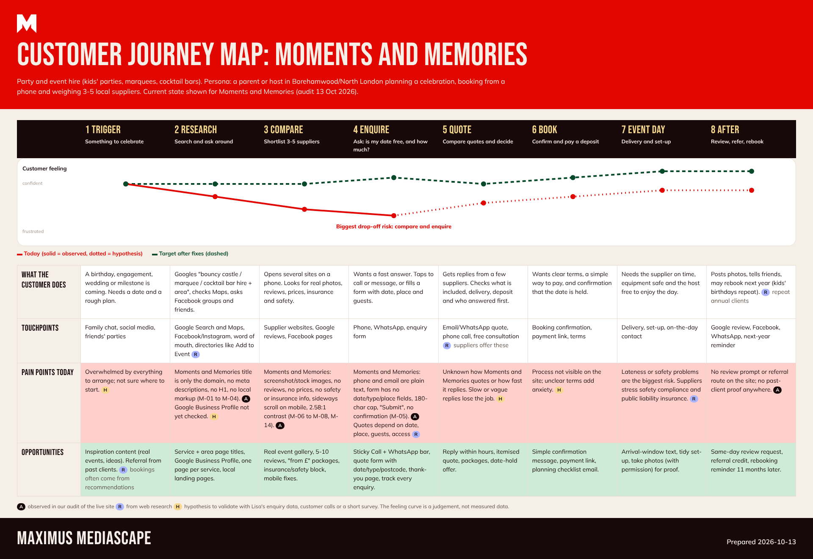

# Customer journey: party and event hire

Editable version: `assets/customer-journey-map.html`.

**Persona:** a parent or host in Borehamwood/North London planning a kids' party, birthday, engagement or wedding, booking from a phone and comparing 3-5 local suppliers.

**Stages:** Trigger, Research, Compare, Enquire, Quote, Book, Event day, After.

## Where Moments and Memories loses people
1. **Research:** the site is hard to find. Titles are only the domain, there are no descriptions, and no local markup was found (M-01 to M-04). Whether she has a Google Business Profile is **not yet checked**.
2. **Compare:** the site gives no reason to choose it: no reviews, prices, real photos or safety/insurance information, and it is hard to read on a phone (M-06 to M-08, M-14).
3. **Enquire:** there is no tap-to-call or WhatsApp, and the form asks for nothing that lets Lisa quote (M-05).

Stages 5-8 (quote, book, event day, after) are not visible from the website. They need Lisa's input before we rely on them.

## How strong is the evidence?
- **A (audit):** observed on the live site on 2026-10-13. Strongest.
- **R (research):** thin. Web searches found no survey on how UK customers choose party hire, so these points come from supplier and marketplace pages and general local-search statistics. Treat them as pointers, not proof.
- **H (hypothesis):** to be checked against Lisa's real enquiries, a few customer calls, or a short survey.
- The emotion curve is a judgement, not measured data.

## What the research did show
- **Quoting depends on details:** event date, location, guest numbers and access (grass vs hard standing) change the price, so a quote form should ask for them. ([Add to Event](https://www.addtoevent.co.uk/listings/bouncy-castle/england), supplier pages)
- **Marketplaces compare suppliers:** customers send one request and get several quotes, so reply speed and clarity decide who wins. ([Add to Event](https://addtoevent.co.uk/listings/marquees/essex))
- **Suppliers sell on safety and insurance:** public liability cover and health-and-safety compliance are standard claims. ([Cobham Marquees](https://cobhammarquees.co.uk/what-we-do/party-marquees))
- **Referrals and repeat clients matter:** several suppliers say much of their business comes from recommendations and annual returns.
- **Reviews drive local choice, but figures are second-hand:** vendor summaries of BrightLocal and SOCi data say most people read reviews and that a higher rating raises calls and clicks. These are US/global figures from aggregator blogs, so verify the originals before quoting them to a client. ([BrightLocal](https://brightlocal.com/research/local-seo-statistics/), [Shapo summary](https://shapo.io/blog/google-review-statistics/))
- **Journey-mapping format:** stages, touchpoints, emotions, pain points and opportunities follow standard practice. ([NY State guide](https://www.ny.gov/customer-journey-mapping), [UXPressia event template](https://uxpressia.com/blog/event-attendee-journey-template))
- **Not found:** WhatsApp-specific data for local service businesses.

## To validate next
- Ask Lisa: where do enquiries come from, how long does she take to reply, what share of quotes turn into bookings, and how many clients rebook?
- Add call, WhatsApp and form tracking before changing the site, so the "enquire" step can be measured.
