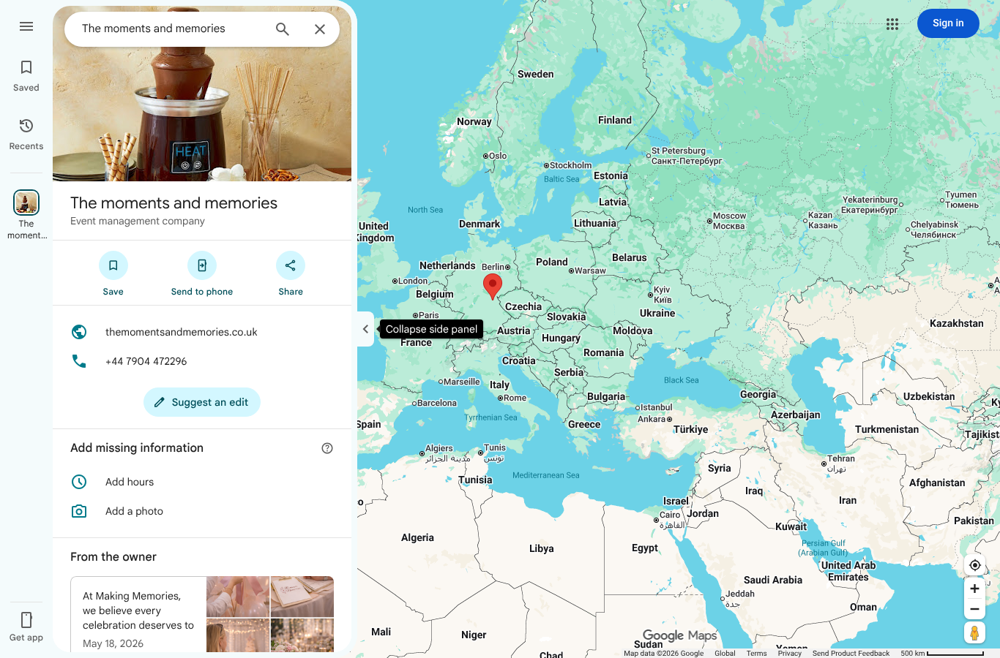
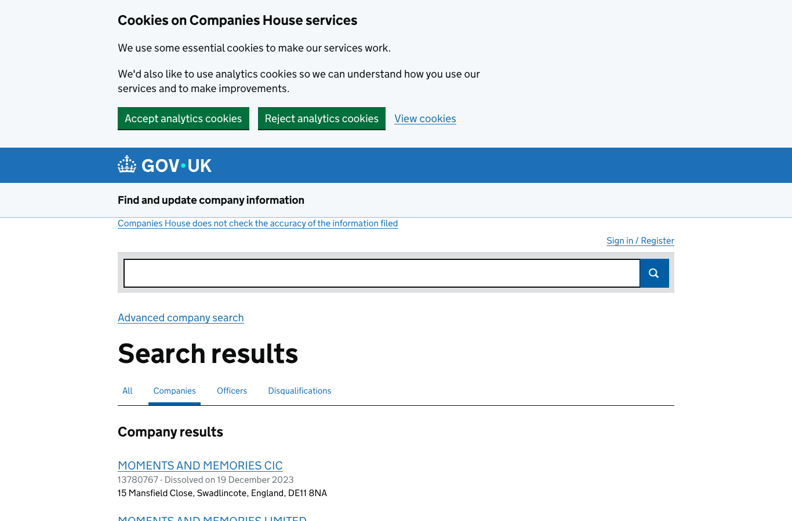
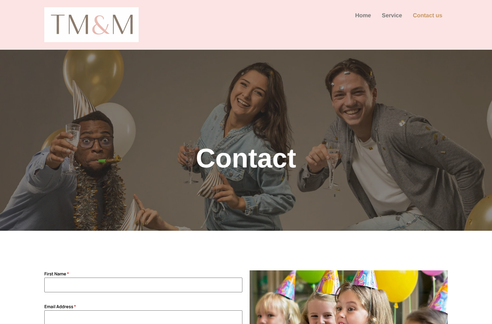
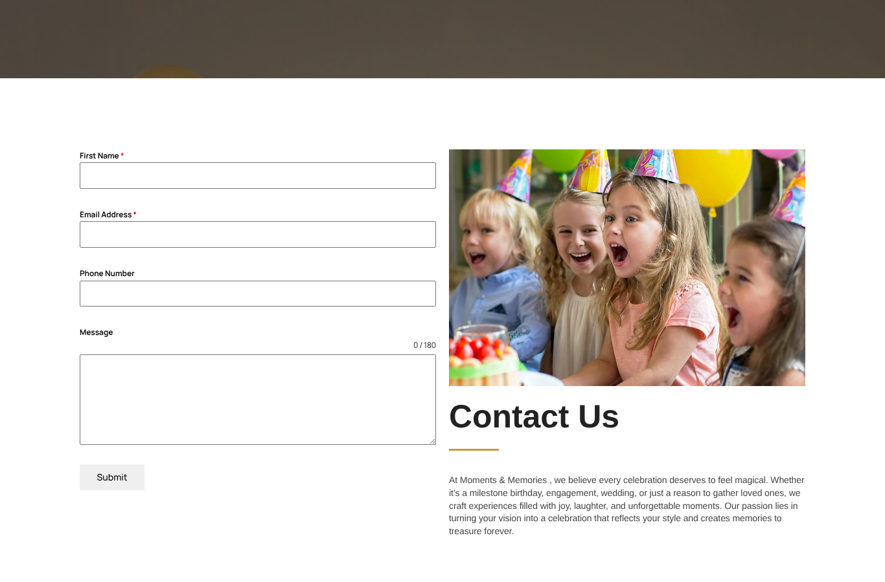
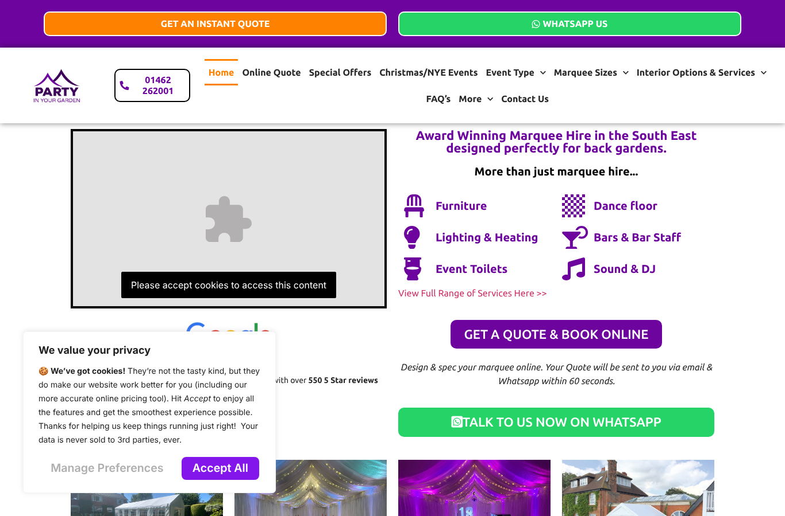
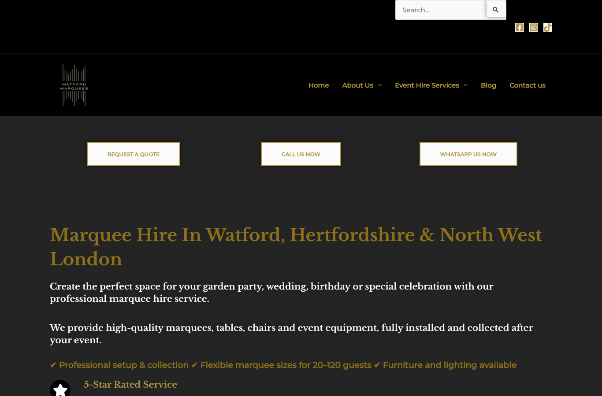
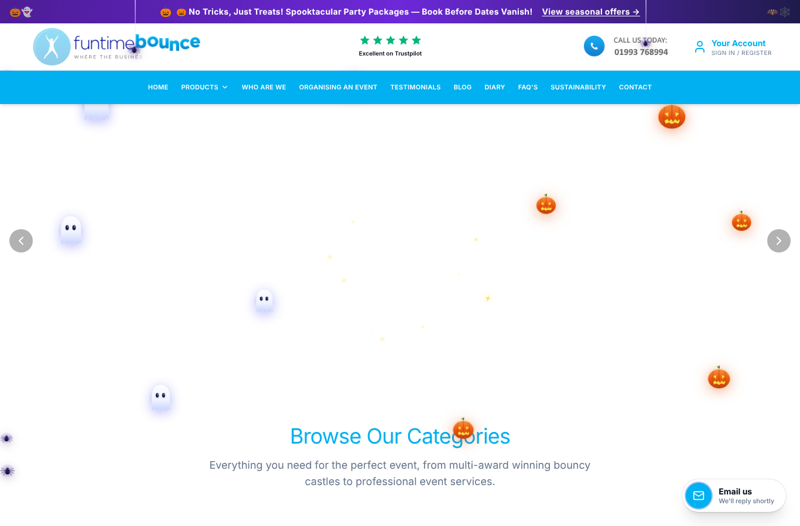

# Lead research report: Moments and Memories

**Lead:** Lisa Henderson, self-employed, Borehamwood. **Website:** themomentsandmemories.co.uk. **Researched:** 13 October 2026. **Prepared for:** the Maximus Mediascape team (internal). Contact details are in the CRM, not in this report.

How to read the tags: **[A]** I saw it myself and saved the evidence. **[R]** it comes from outside research, with a link. **[H]** it is my judgement or hypothesis. **[N]** I could not check it.

## 1. Summary: what you need to know

I researched this lead from the form she filled in, then looked at her website, her public footprint, four similar businesses and two quote marketplaces. This is what I came across.

1. **She runs a very young online business.** Her domain was registered on 16 December 2025 and is due to renew on 16 December 2026 [A, public registry]. Her Google listing carries an owner post dated 18 May 2026 [A]. She is self-employed and I found no registered company in her name [A].
2. **Her website is a simple three-page WordPress site** with sample and template pages left public [A]. It is fast enough, but it has no reason to convert a visitor into an enquiry.
3. **The biggest problems are about enquiries, not technology.** No tap-to-call or WhatsApp, a form that doesn't ask for event type or date, no prices, reviews or real photos, generic page titles, and **no analytics at all** [A].
4. **She does have a Google listing** but it looks barely filled in: no address, hours, rating or reviews visible in the signed-out view [A, limited view].
5. **Competitors use the same kind of technology as she does** (WordPress and Elementor). Their advantage is what they put on the page and that they measure it [A].
6. **There is a realistic fit with our Starter plan** (from £999 plus VAT, one-off), which covers most of the problems I found [A, from our own pages]. Her budget and goals are unknown [N].
7. **Not yet verified:** her Facebook and Instagram, her Google rating and reviews, whether she runs ads, how much demand there is for her services, and what her form said about being contacted [N].

Overall, I'd rate her online presence **4 out of 10**, as a judgement [H]. She is a **warm** lead [H]: weak presentation and no tracking, but an unconfirmed budget.

## 2. How I did the research

| Step | What I did | Tool | Result |
|---|---|---|---|
| Website | Loaded the home, service and contact pages on desktop and mobile, took screenshots | Headless Chromium (Playwright) | Worked after waiting out the host's "checking your browser" screen |
| SEO | Crawled the site against 52 rules | jev-seo (open source) | 8 URLs, 11 findings. It scored 95/100, but that score only checks tags and headers and is **not** a quality score |
| Speed and accessibility | Ran Lighthouse (mobile and desktop) and Pa11y (axe) | Lighthouse, Pa11y | See section 4 |
| Technology | Detected platform, hosting and tracking tools | wappalyzer-next, with a manual check of the page source | Worked in fast mode |
| Public footprint | Google Maps, Companies House, domain registry, her sitemap | Chromium and public records | Worked |
| Competitors | Homepages, screenshots, technology and Google Maps ratings for four businesses and two marketplaces | Same | Worked |
| Our offer | Read our own sitemap and plan pages | Direct fetch | Prices confirmed 13 Oct 2026 |

**What I could not do** [N]: Google Search (blocked by a robot check), Facebook and Instagram (login walls or errors), Yell (blocked) and Trustpilot (error). The Wayback Machine was not reachable from this environment, so I do not know how her site looked earlier. A Meta Ad Library search returned only unrelated advertisers, so I can't say whether she runs ads. The browser plugin could not start here because it needs a Chrome that is already open. Keyword demand needs Google Keyword Planner data, which I do not have yet.

Raw files, screenshots and checksums are listed in the appendix.

## 3. The lead

### 3.1 What she told us
The form gave her name, city (Borehamwood), the company "Self employed. Moments and memories." and her interest, "My Market Share (Digital Marketing & Lead Gen)" [A, from the lead details]. The wording "small startup, can't afford big agency retainers, need aggressive growth, let's see if we're a fit" arrived with the lead text. **I can't tell whether Lisa wrote it or it is campaign copy**, so I am not treating it as her words [N].

### 3.2 What is public about her and the business

| Item | What I found | Tag |
|---|---|---|
| Business type | Self-employed events business: kids' parties, marquees and decor, cocktail bars and catering | A |
| Company registration | Companies House search: no active company named Moments and Memories at Borehamwood. Similar names are dissolved or in other towns. "Moments 2 Memories Limited" (Nuneaton, incorporated 30 June 2026) looks unrelated. This fits a sole trader but does not prove it | A |
| Domain | Registered 16 Dec 2025 through registrar AXIDOMAINS, expires 16 Dec 2026, nameservers are ns1 and ns2.dns-parking.com. The registrant is hidden | A |
| Hosting | Hostinger with LiteSpeed cache | A |
| Address | Her website footer shows an address in central London (EC1V). She is based in Borehamwood. They conflict | A |
| Phone | The number on her website and Google listing matches the one on the form, so there appears to be no separate business line | A |
| Email | The site shows a Gmail address, not an address on her own domain | A |
| LinkedIn | None, per the team | A |
| Facebook, Instagram | Not checked (blocked) | N |

### 3.3 Her Google listing
I searched Google Maps without signing in. A listing exists: "The moments and memories", category Event management company, with her website and phone number [A].

- It has an owner description dated 18 May 2026 whose wording is copied from her website, including the line "At **Making** Memories" (the brand name is inconsistent) [A].
- The page offers "Add hours" and "Add a photo", and shows no address, hours, rating or review count. The map pin sat in central Europe [A]. This may be only a limited signed-out view, so it needs a signed-in check [N].

## 4. Her website

### 4.1 What it is
A WordPress 6.8 site built with Elementor, on Hostinger. It has three real pages (Home, Service, Contact us) plus a "hello-world" post, an author page and template pages that are public [A].

### 4.2 Speed and accessibility (home page)
| Measure | Mobile | Desktop |
|---|---|---|
| Lighthouse performance | 86 | 95 |
| Largest content shown | 3.8 s (above the 2.5 s "good" mark) | 1.3 s |
| Accessibility | 97 | 93 |
| SEO | 92 | 92 |

Speed is acceptable, not a blocker [A]. The accessibility problems are all **colour contrast**: white text on her gold is 2.58 to 1, where 4.5 to 1 is the standard. Pa11y found 24 contrast violations on the home page, 34 on the service page and 4 on the contact page, and nothing else [A]. The page also scrolls sideways on a phone (410 px wide in a 390 px screen) [A].

### 4.3 What I found, by importance

| ID | Area | Severity | Finding | Evidence |
|---|---|---|---|---|
| M-15 | Measurement | High | **No analytics or tracking tags** (no Google Analytics, Tag Manager, Facebook Pixel or Clarity) | Homepage HTML and technology scan |
| M-05 | Conversion | High | Phone and email are plain text, no tap-to-call or WhatsApp. The form has First name, Email, Phone and Message with a 180-character limit, and no event type, date or place | Screenshots |
| M-01 to M-03 | SEO | High | Every page title is just the domain. No meta descriptions on the 6 indexable pages. No H1 heading on the home, service or contact pages | jev-seo report |
| M-06 | Trust | High | No reviews, prices, real event photos, FAQs or safety and insurance information | Screenshots |
| M-04 | Local | High | No local business markup. The footer address conflicts with where she is based | Page source, footer |
| (new) | Legal | Medium | **No privacy, cookie or terms pages or links**, and no cookie notice seen. The common addresses return "not found" | `assets/sources/legal-and-sitemap-checks-2026-10-13.txt` |
| M-07, M-14 | Mobile, accessibility | Medium | Sideways scroll on phones; contrast failures | Lighthouse, Pa11y |
| M-08, M-09 | Design, content | Medium | Hero and card images look like screenshots (judging by file names). Brand name appears as "Making Memories" in places. One long Services page. A thin Contact page | Page source, screenshots |
| M-11 | Housekeeping | Medium | Sample "hello-world" post, an author page that exposes a username, and template pages are public and in the sitemap | Sitemap |
| M-10 | Performance | Low | Mobile LCP 3.8 s, plugin-heavy page (27 scripts, 37 stylesheets), some failing requests | Lighthouse |
| M-12, M-13 | Hygiene | Low | No favicon, missing share tags and some security headers; newsletter box with no offer; "proudly powered by WordPress" footer | jev-seo |

The full table with fixes is in `findings.md`.

### 4.4 Technology
WordPress 6.8, Elementor and Header and Footer Builder, jQuery, particles.js, Hostinger with LiteSpeed, PHP 8.2. No analytics tool detected [A]. Two competitors run a newer WordPress release (7.1) [A]. Her version can be confirmed in her dashboard before anyone says it is out of date [N].

## 5. Competitors

I picked four similar businesses and two quote marketplaces from search results. This is a small sample of homepages only, so it shows patterns, not the whole market [H]. I did not find a hirer based in Borehamwood itself.

### 5.1 Who and what they use
| Business | What they do | Tools detected | Google rating (signed out) |
|---|---|---|---|
| [Party in Your Garden](https://www.partyinyourgarden.co.uk/) | Garden marquees, furniture, lighting, bars | WordPress, Elementor, Rank Math, Cloudflare, WP Rocket, CookieYes, Tag Manager, Fluent Forms | 4.9 |
| [Watford Marquees](https://watfordmarquees.co.uk/) | Marquee and furniture hire | WordPress, Astra, Elementor, Rank Math, WPForms, Hotjar, Google Analytics, NitroPack | 5.0 |
| [Active Softplay](https://www.activesoftplay.co.uk/) | Bouncy castles and soft play | ASP.NET, Telerik, Bootstrap, Cloudflare, Cloudinary, Google Analytics, WhatsApp chat | 4.9 |
| [Funtime Bounce](https://funtimebounce.co.uk/) | Bouncy castles, inflatables, simulators | Cloudflare, Google Analytics, Tag Manager | Not captured (the Maps search matched a different business) |
| [Add to Event](https://www.addtoevent.co.uk/), [Eventsense](https://www.eventsense.co.uk/) | Marketplaces where customers get several quotes | Google Analytics, review widgets | n/a |

Review counts were not captured. Party in Your Garden states "550 5 Star reviews" on its own homepage [A, their claim]. Ratings are signed-out Google Maps values matched by business name [A].

### 5.2 What they do on their pages
| | Party in Your Garden | Watford Marquees | Active Softplay | Funtime Bounce |
|---|---|---|---|---|
| Phone visible | Top of every page | Yes | Large, top | Yes |
| WhatsApp | Prominent, many links | Yes | Yes | No |
| Main button | "Get an instant quote" | "Request a quote" | "Details and Bookings" | "Book now" |
| Prices on homepage | A £100 figure and special offers | None | About £110 to £175 per item | About £315 to £625 per item |
| Proof | "550 5 Star reviews" badge, case studies, testimonials | Mentions reviews | Reviews and trade badges | Testimonials, awards |
| Safety or insurance wording found | Not found | Not found | Yes | Yes |
| Area in title or headline | Region only | **Yes: "Watford, Hertfordshire and North West London"** | Yes | No |
| Navigation by | Event type, marquee size, services | Five generic links | Products | Ten links |
| Seasonal pages | **Christmas and New Year, special offers 2026/2027** | Not seen | Not seen | Not seen |

### 5.3 What they do well [A]
1. **Quote, WhatsApp and phone in a bar at the top of every page**, repeated on mobile (Party in Your Garden).
2. **A reply promise.** "Your quote will be sent within 60 seconds."
3. **Choose by what you are planning**, not by catalogue.
4. **Prices up front** on two of the four.
5. **Proof next to the main button.**
6. **Local wording** in the title and headline (Watford Marquees).
7. **They measure.** All four run Google Analytics or Tag Manager, and Watford Marquees also uses Hotjar (heatmaps).

### 5.4 Where they are weak [A, small sample]
- **Each covers one slice.** None presented kids' parties, marquees, cocktail bars and weddings together [H, small sample].
- **Clutter and thinness.** Active Softplay is very busy. The Watford Marquees homepage has about 99 words and no prices.
- **Friction on phones.** On Party in Your Garden a cookie pop-up covers much of the first screen on a phone and its main video won't play until cookies are accepted.
- **Marketplaces win on speed**: the customer sends one request and gets several quotes [R, [Add to Event](https://www.addtoevent.co.uk/)].

## 6. The gaps, in order of importance

| # | Gap compared with the competitors | Why it matters |
|---|---|---|
| 1 | No tracking | She can't tell which visits become enquiries. All four competitors run Google Analytics or Tag Manager |
| 2 | No quick contact (tap-to-call, WhatsApp, quote form with date and event type) | The strongest competitors lead with these |
| 3 | No prices or packages | Two of four show prices |
| 4 | No proof (reviews, real photos, safety and insurance) | Customers compare suppliers before enquiring [H] |
| 5 | Weak local signals (generic titles, no markup, address conflict, thin Google listing) | Competitors put the area in titles and use local markup |
| 6 | No legal pages or cookie notice | Basic trust and compliance |
| 7 | Mobile and contrast problems | Visitors on phones, readability |
| 8 | No seasonal offers | Christmas and New Year parties are being booked now [H] |

## 7. Room for improvement and how we would solve it

Prices and scope are from our own site, checked on 13 Oct 2026 and to be confirmed before quoting [A].

| Option | Price | Covers |
|---|---|---|
| Free 15-minute website check | Free | Our entry offer |
| **Starter** | **From £999 plus VAT**, one-off, 50% to start, about 2 months, up to 5 pages, 2 revisions, client owns the site | Bespoke mobile site, click-to-call and WhatsApp button, working form, Google listing set-up, analytics and Search Console, reviews kit, legal pages and cookie notice, AI-search-ready FAQ and structured data, 90-day plan, 30 days support |
| **Care** | £599 a month plus VAT | Monthly visibility work: listing posts, articles, social, reporting |
| **Growth** | £999 a month plus VAT, plus ad spend (at least £300, £500 recommended) | Care plus tracking, a managed ad campaign, email and a lead chatbot |
| Website Redesign and Optimisation | Quoted | If she wants to keep and fix her current site |

Not included in Starter: domain, hosting and email running costs, paid ads, extensive copy or photography, shops or booking systems.

**How the findings map to Starter** [H]: analytics, tap-to-call, WhatsApp, a better form, titles and headings, local markup, a Google listing set-up, legal pages, mobile and contrast fixes and the reviews kit are all covered. Real photos, prices and written copy need her input.

**Scope:** a full new site for her could need about 10 pages, but Starter covers 5. A sensible split is a first phase of Home, Services (one page), Gallery and reviews, Get a quote, and About and contact, then separate service and area pages later [H].

## 8. Qualification

| Question | Status |
|---|---|
| Need | Clear: weak presentation, no tracking, no quick contact [A] |
| Budget | Unknown [N]. Starter is a one-off from £999 plus VAT; Growth with ad spend may be too much |
| Decision-maker | Probably Lisa herself, as she is self-employed [H] |
| Timing | Unknown [N]. Christmas and New Year bookings are likely under way [H]. Her domain renews on 16 Dec 2026 [A] |
| Fit with our offer | Good, mainly Starter [H] |
| Consent to contact | Not checked: I have not seen what the form said about being contacted, or by which channel [N] |

**Lead score: warm** [H], using the local-business rubric from the marketingskills project (weak online presentation, active status unconfirmed).

## 9. Risks, unknowns and what would change my mind

- **Active or not?** I have not seen a rating, reviews or recent posts, so I can't say how busy she is [N]. If her Google listing turns out to have many recent reviews, the picture changes: she would be more established than I assume.
- **Budget.** If she can't spend about £999, Starter may be out of reach and we would need a smaller first step [N].
- **Her own site.** Does she control her hosting and domain logins, who built it, and does she want a rebuild or fixes? [N]
- **Compliance.** She is self-employed, so likely a sole trader. My understanding from the marketingskills notes is that sole traders are treated like individuals for marketing messages, and that TPS applies to marketing calls. That is from an open-source repo, not a legal source, so check it on the ICO website [R].
- **Demand.** I have no search volume or ranking data for terms like "bouncy castle hire Borehamwood" [N]. Google Keyword Planner data would close this.
- **Reading screenshots.** Everything from the signed-out Google view might change when seen signed in.

## 10. Still to do before the call
1. Check her Google listing signed in (rating, reviews, address, hours, photos).
2. Check her Facebook and Instagram.
3. Look at what the form said about contact and consent.
4. Check her number against TPS.
5. Get keyword demand for her services and area.
6. Confirm our prices.

## Appendix: evidence and sources

<!--MANIFEST-->

**Open-source tools used:** [jev-seo](https://github.com/AgriciDaniel/jev-seo) (MIT), [marketingskills](https://github.com/coreyhaines31/marketingskills) (MIT), [wappalyzer-next](https://github.com/s0md3v/wappalyzer-next) (GPL-3.0), Lighthouse, Pa11y. **Our offer:** [Starter plan](https://maximusmediascape.com/our-services/starter-plan/), [Care and Growth plans](https://maximusmediascape.com/our-services/care-and-growth-plans/). Other documents: `findings.md`, `competitor-research.md`, `gap-analysis-and-solution.md`, `customer-journey.md`, `call-brief.json` (call plan and script).
