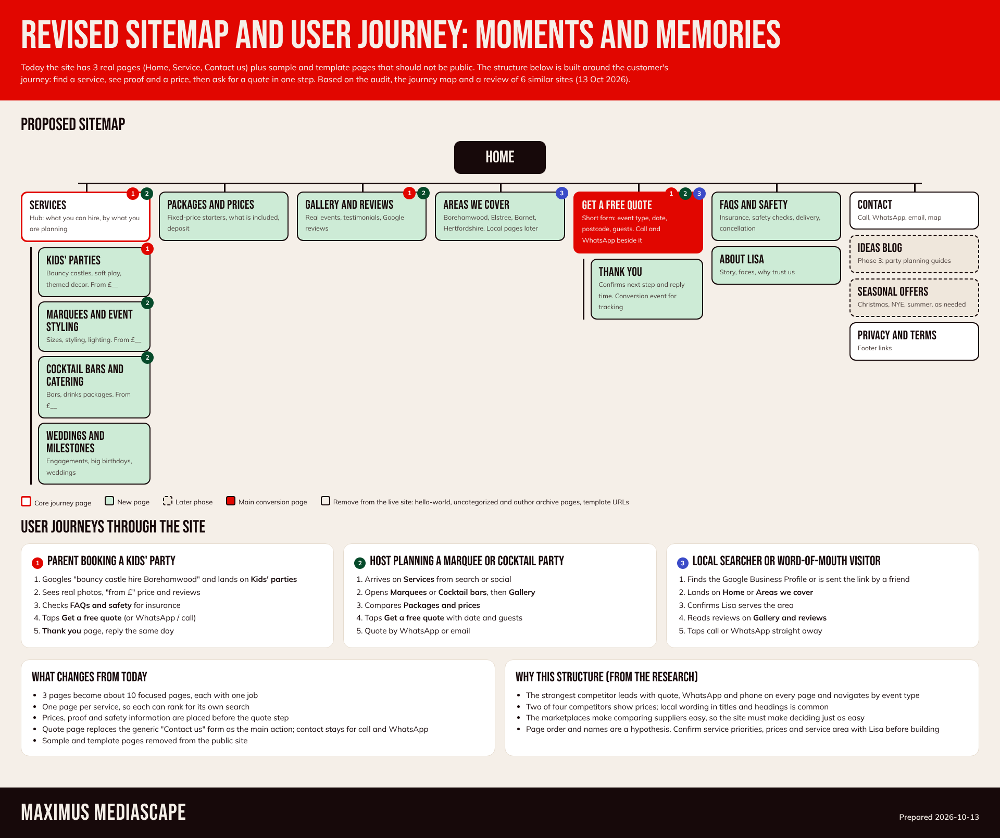

# Revised sitemap and user journey

Editable version: `assets/sitemap-journey.html`.

## Today
Three real pages: Home, Service, Contact us. Sample and template pages (hello-world, uncategorized, author archive, template URLs) are public and should not be.

## Proposed (about 10 pages, each with one job)
Home, Services (hub) with four service pages (kids' parties, marquees and event styling, cocktail bars and catering, weddings and milestones), Packages and prices, Gallery and reviews, Areas we cover, Get a free quote with a Thank you page, FAQs and safety, About, Contact, Privacy and terms. Later: Ideas blog, seasonal offers.

## Three journeys
1. **Parent booking a kids' party:** search, Kids' parties, reviews and price, FAQs and safety, quote, thank you.
2. **Host planning a marquee or cocktail party:** Services, Marquees or Cocktail bars, Gallery, Packages, quote.
3. **Local or word-of-mouth visitor:** Google Business Profile or a friend's link, Home or Areas we cover, reviews, call or WhatsApp.

## Basis and limits
Built from the audit findings (M-01 to M-14), the customer journey map and the competitor review (6 sites, homepages only). Page names, order, prices and service area are a hypothesis until Lisa confirms them: which services bring most work, real prices and deposit terms, real service area and address, and how fast she can reply.
