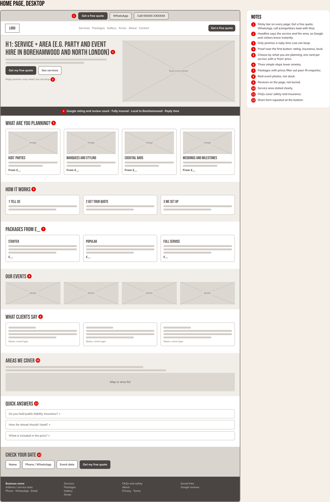
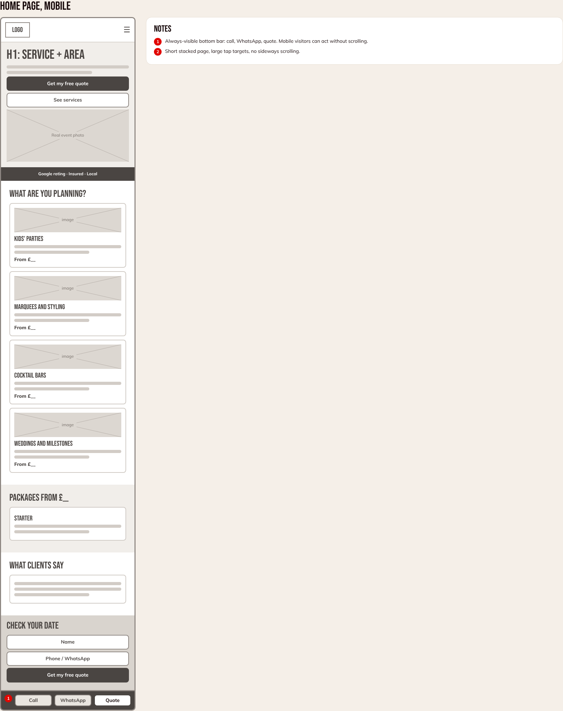
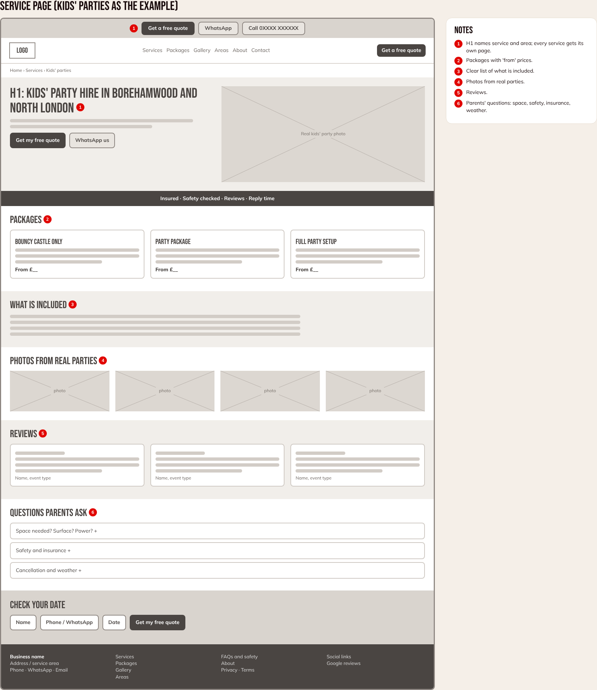
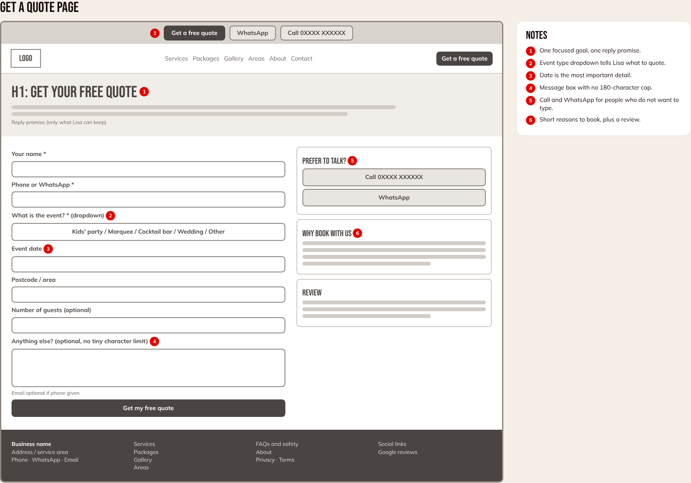

# Low-fidelity wireframes (for client presentation)

Structure and priorities only: not final design, copy or prices. Grey boxes are images, "£__" is a price still to be confirmed, red numbers match the notes beside each page. Layout choices follow the audit, the customer journey and the competitor review.

| Page | Image | Main job |
|---|---|---|
| Home, desktop | `assets/wireframe-home.png` | Say what, where and why trust us; start a quote |
| Home, mobile | `assets/wireframe-mobile.png` | Same, with a sticky Call / WhatsApp / Quote bar |
| Service page (kids' parties as the example) | `assets/wireframe-service.png` | Packages, proof, answers, quote |
| Get a quote | `assets/wireframe-quote.png` | One short form, plus call and WhatsApp |
| Thank you | `assets/wireframe-thanks.png` | Confirm next step, fire the conversion event |

Whole set on one sheet: `assets/wireframes-full.png`. Editable HTML: `assets/wireframes.html`.

## Design decisions and where they come from
- **Quote, WhatsApp and call at the top of every page (and sticky on mobile):** the strongest competitor does this; Lisa's site has none (M-05).
- **Service and area in the headline:** local wording in titles and headings (M-01, M-03, M-04).
- **"From" prices and packages:** two of four competitors show prices (M-06).
- **Proof beside the first button:** rating, insurance, reviews, real photos (M-06, M-08).
- **Quote form asks for event type, date, area and guests, and has no 180-character cap:** it gives Lisa what she needs to quote (M-05).
- **One page per service:** each can rank for its own search (M-09).

## Not decided yet (needs Lisa or the client's brand)
Colours, fonts, logo, real photography, copy and prices. This stage tests structure only. The client should react to the order and content of sections, not to the look.
